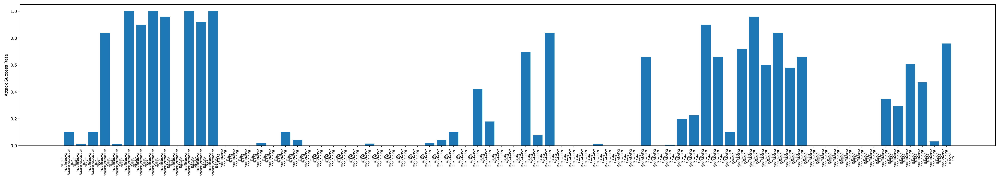

# Result Smart App Attack

[](https://github.com/vynqan1122/result_smart_App_Attack/actions/workflows/repository-checks.yml)

Research reproduction and experimental artifacts for assessing the adversarial robustness of image classifiers deployed with TensorFlow Lite.

**English** | [Tiếng Việt (original experimental guide)](README.vi.md)

## Purpose and research impact

This repository makes SmartAppAttack-related experiments easier to inspect, reproduce, and compare. It brings together Python implementations, binary classification training scripts, TensorFlow Lite conversion, evaluation summaries, and learning curves for AI security education and research.

It is an independent reproduction and extension of published research, not the official SmartAppAttack repository or a claim of authorship of the original methods. The intended audience is students, researchers, and engineers studying model robustness in controlled, authorized environments.

## What is available

| Artifact or capability | Scope |
| --- | --- |
| Evaluation summary | 74 recorded configurations in the current appendix CSV: GTSRB / MobileNetV2, 50 images per row |
| Training figures | GTSRB, CIFAR10, FLOWERS; MobileNetV2, InceptionV3, ResNet50V2 |
| Training modes | Feature extraction and fine-tuning |
| Baseline labels | PMA, BAMA, E-BAMA |
| Evaluation methods represented in appendix | FGSM, CAN, CW, PGD, MI-FGSM (MIFGSM in the CSV) |
| Reproducibility tooling | Dataset preparation, training, conversion, evaluation and summary generation scripts |

The training figures cover a broader set of datasets and architectures than the published appendix evaluation results. They do not establish completed adversarial evaluations for all combinations. The CSV is a snapshot, not a package download or adoption metric.

## Results and interpretation

Read the [benchmark guide](docs/BENCHMARKS.md) and inspect the [appendix CSV](appendix_outputs/attack_summary.csv) before comparing results.



Attack success rate (ASR) is stored as a fraction from 0 to 1. The experiment measures changes in predictions for target-class images; compare only configurations with matching evaluation conditions. Different methods, perturbation budgets, model variants and sampling choices can limit comparability. An ASR of zero is not proof that a model is secure.

## Repository layout

| Path | Purpose |
| --- | --- |
| `appendix_outputs/` | Primary recorded CSV and summary figure |
| `figures/figures/` | Training accuracy and loss curves |
| `make_datasets.py` | Binary dataset preparation |
| `backbone_utils.py` | Model and preprocessing utilities |
| `fea_ext_binary.py`, `fin_tun_binary.py` | Training workflows |
| `tflite_converter.py` | TensorFlow Lite conversion |
| `attack_common.py`, `PMA.py`, `BAMA.py`, `E-BAMA.py` | Existing experimental evaluation implementation |
| `summarize_results.py` | Summarization from local experiment JSON files |
| `fixed_code/` | Historical copies of modified scripts |
| `tests/` | Lightweight repository and artifact checks |

## Getting started

Review the repository and licensing notes before reusing code or data. The historical environment specifies TensorFlow 2.8.0, NumPy 1.23.5, Foolbox 3.3.3 and EagerPy 0.30.0. A separate Python 3.10 environment is a reasonable starting point for investigating compatibility with these older dependencies, not a verified lockfile or supported-platform guarantee.

```sh
git clone https://github.com/vynqan1122/result_smart_App_Attack.git
cd result_smart_App_Attack
python -m venv .venv
# Linux/macOS: source .venv/bin/activate
# Windows PowerShell: .venv\Scripts\Activate.ps1
python -m pip install -r smartappattack_requirements.txt
```

Dependency resolution, GPU support, datasets and pretrained weights may require additional setup. For the original experimental workflow and parameter descriptions, see [README.vi.md](README.vi.md). Dataset preparation writes outside the repository in the sibling datasets directory; confirm available disk space first. Use only models, datasets and environments you have permission to evaluate.

Existing aggregate figures and CSV files can be inspected without TensorFlow. Full reproduction requires dataset provenance, compatible dependencies, appropriate models and raw experiment outputs. The raw JSON results and trained model artifacts are not included in this snapshot. Do not run the summarizer over an empty results directory: it can overwrite the committed aggregate CSV.

## Repository checks

```sh
python -m unittest discover -s tests -v
```

The GitHub Actions workflow performs dependency-free Python syntax and benchmark artifact checks. These checks do not train models, verify GPU support, rerun experiments, or independently validate the scientific conclusions.

## Contributing and roadmap

See [CONTRIBUTING.md](CONTRIBUTING.md), [ROADMAP.md](ROADMAP.md), and [SECURITY.md](SECURITY.md). Contributions that improve reproducibility, documentation, evaluation validity and defensive robustness are especially welcome, subject to the rights and provenance requirements in [LICENSING.md](LICENSING.md).

## Citation and attribution

If you use this repository, cite the specific commit or version and the original study:

> Yujin Huang and Chunyang Chen. Smart App Attack: Hacking Deep Learning Models in Android Apps. IEEE Transactions on Information Forensics and Security, vol. 17, pp. 1827–1840, 2022. DOI: [10.1109/TIFS.2022.3172213](https://doi.org/10.1109/TIFS.2022.3172213).

Original research code: [Jinxhy/SmartAppAttack](https://github.com/Jinxhy/SmartAppAttack). See [CITATION.cff](CITATION.cff) for machine-readable citation metadata.

## Licensing and responsible use

The repository is publicly accessible; a repository-wide open-source license has not yet been established. Public visibility does not by itself grant reuse or redistribution rights. See [LICENSING.md](LICENSING.md). Research should be performed only on authorized models and datasets, with the objective of understanding and improving security.
