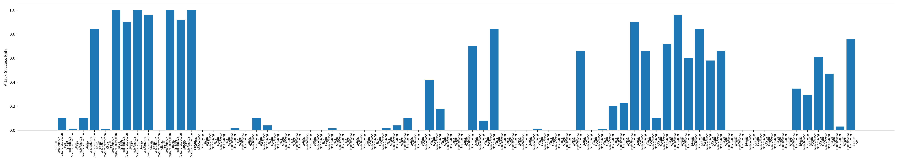

# Benchmark snapshot and interpretation

Source: [appendix_outputs/attack_summary.csv](../appendix_outputs/attack_summary.csv). The following describes the committed snapshot reviewed for this documentation update, not newly run experiments.

## Coverage

The appendix CSV contains 74 rows, all from GTSRB / MobileNetV2, with 50 images recorded per row. It contains feature extraction and fine-tuning results, PMA/BAMA/E-BAMA baseline labels, and FGSM, CAN, CW, PGD and MIFGSM method labels. The repository separately contains training loss/accuracy figures for GTSRB, CIFAR10 and FLOWERS using MobileNetV2, InceptionV3 and ResNet50V2. Training plots do not imply complete robustness evaluation coverage.

## Selected feature-extraction results

Mean ASR, displayed as percentages and rounded to two decimal places. A dash denotes no matching row in this snapshot, not zero.

| Baseline | FGSM | CAN | CW | PGD | MI-FGSM |
| --- | ---: | ---: | ---: | ---: | ---: |
| PMA | 10.00% | 1.32% | 10.00% | — | — |
| BAMA | 84.00% | 1.20% | 90.00% | 100.00% | 100.00% |
| E-BAMA | 96.00% | 0.00% | 92.00% | 100.00% | 100.00% |

All entries shown are recorded on GTSRB / MobileNetV2 with 50 images per row. The recorded epsilon is 8.0 for FGSM/PGD/MI-FGSM and 20.0 for CAN/CW; these are not identical evaluation conditions. The CSV uses MIFGSM for MI-FGSM. PMA refers to a baseline label in the experiment, not a defensive method.

## CSV fields

| Field | Meaning |
| --- | --- |
| dataset, backbone | Dataset and network architecture |
| training_mode, baseline, attack_algo, model_name | Experiment identifiers |
| epsilon | Recorded perturbation parameter; consult the implementation for method-specific semantics |
| num_images | Recorded image count for a configuration |
| mean_success_rate, min_success_rate, max_success_rate | Recorded ASR statistics as fractions |
| path | Historical raw result JSON path, which may not exist in the current checkout |

## Limitations and reproducibility

- These are recorded aggregate results, not independently rerun or verified measurements.
- The raw JSON outputs, exact split manifests, complete trained model artifacts and run-specific environment metadata are not included in the current checkout.
- Comparisons across different models, methods, perturbation parameters or sample selections require care. The percentages cannot establish deployment safety.
- The root-level CSV is a separate summary snapshot; use the appendix CSV for the table above.
- A future benchmark release should record clean performance, precise ASR denominator, dataset splits, seeds, run counts, software versions, model identifiers, hardware and uncertainty. Preserve prior snapshots and document any changes.

The repository checks validate CSV structure, numeric bounds and artifact presence. They do not verify model behavior or scientific conclusions.
